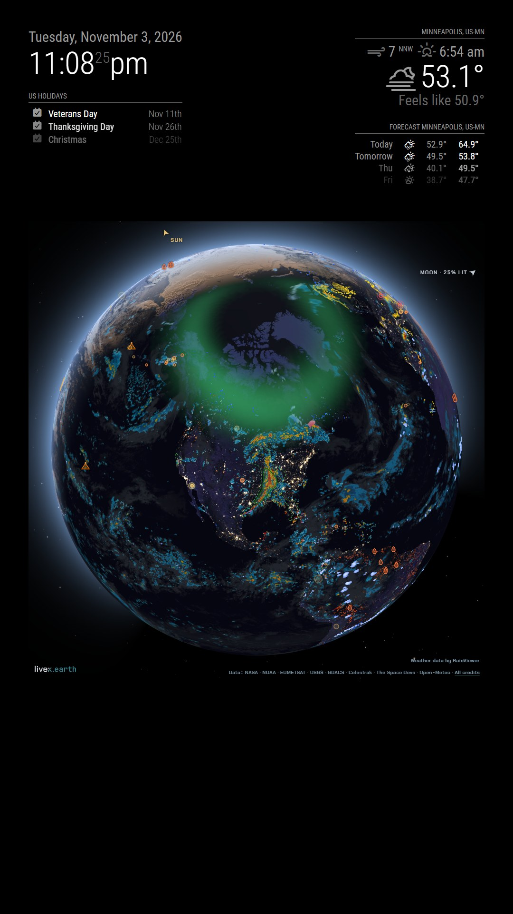

# MMM-LiveX

A [MagicMirror²](https://magicmirror.builders/) module showing [livex.earth](https://livex.earth/),
the live globe: the Earth as it is right now, lit by the real Sun. Day and night divide it
along the terminator, the night side glows with city lights, and the Sun and Moon are marked
where they are. Over it go hourly clouds, the radar, the aurora, satellites and rocket
launches, and hazards from earthquakes to tropical storms. Space is black, so on a mirror the
globe hangs in the glass.



## Installing

```sh
cd ~/MagicMirror/modules
git clone https://github.com/rdmiller/MMM-LiveX
```

There's nothing to `npm install`. Add the module to `config/config.js`:

```js
{
  module: 'MMM-LiveX',
  position: 'middle_center',
  config: {
    lat: 44.98,
    lon: -93.27,
  },
},
```

**Turn on the GPU.** The globe is drawn with WebGL2, and MagicMirror starts Electron with the
GPU off unless `ELECTRON_ENABLE_GPU=1` is set. Start it with
`ELECTRON_ENABLE_GPU=1 npm run start`, or add `ELECTRON_ENABLE_GPU=1` to the environment of
whatever starts it (pm2's `env`, a systemd unit's `Environment=`). In server mode, the browser
showing the mirror draws it with its own GPU.

To update: `cd ~/MagicMirror/modules/MMM-LiveX && git pull`.

## The module's own options

| Key | Meaning | Default |
|---|---|---|
| `width` | the globe's width: pixels as a number, or any CSS length (`'40vw'`) | `'480px'` |
| `height` | a fixed height in place of the aspect ratio | none |
| `aspectRatio` | the globe's shape: `1`, `'16:9'`, `'4/3'` | `1` (square) |
| `interactive` | `false`: the globe can't be dragged or clicked (for a touch screen) | `true` |
| `reloadInterval` | how often the page is loaded afresh, in milliseconds, to pick up livex's new releases; `0` never. The data on the globe refreshes itself in between | a day |
| `unloadWhenHidden` | when the module is hidden (by a motion sensor's module, or pages), unload the page, so it isn't drawing behind the glass; it loads again when shown | `true` |
| `baseUrl` | another livex host, for a self-hosted copy | `'https://livex.earth/'` |

For the whole mirror, put it in the `fullscreen_below` region with `width: '100vw'` and
`height: '100vh'`, and the other modules over it.

## livex.earth's options

Every other key in `config` goes into the page's URL: `true`/`false` become `1`/`0`, and a list
is joined with commas. Where the config doesn't say, the module asks for livex's embedded view:

- **`embed`:** `1`: just the globe, the wordmark and the data credits, with no panels or
  controls. It also makes livex's defaults quieter: no status readout, no label cards beside
  hazards and launches (their markers stay), and no satellites but the one `view: 'track'`
  follows. Set `label`, `callouts`, `sats` or `satshow` to have them back, or `embed: false`
  for the full page.
- **`markers`:** `0`, no city names. `markers: true` brings them back.

And it fills in from MagicMirror's own config:

- **`units`:** `imperial` or `metric`, from `units`.
- **`hours`:** `12` or `24`, from `timeFormat`.
- **`clock`:** `local`, so the readout shows your time zone, not UTC.

MagicMirror has no home position of its own, so give the globe one with `lat` and `lon`;
without them it faces latitude 20° on your time zone's meridian.

The quickest way to a view is to set it up on [livex.earth](https://livex.earth/): it writes
every change into the address bar, so the part after `?` is the module's config. For example
`?lat=38&lon=-97&mag=2.6&radar=0&winds=surface` becomes:

```js
config: {
  lat: 38,
  lon: -97,
  mag: 2.6,
  radar: 0,
  winds: 'surface',
},
```

The ones a mirror most often wants:

| Key | Meaning | Default, embedded |
|---|---|---|
| `view` | `fixed` (over a place), `sky` (looking up from `lat`, `lon`), `sunrel` (following the Sun), `orbit`, `moon`, `track` | `fixed` |
| `mag` | size, 0.05–500 (2.6 shows a region, 10 a state) | `1` |
| `track` | for `view: 'track'`: `iss`, `tiangong`, a NORAD number, or `launch` | `iss` |
| `clouds`, `radar`, `severe`, `lightning`, `storms`, `fires`, `quakes`, `tsunami`, `aurora`, `events`, `snow`, `launches`, `lights` | layers on or off | on |
| `markers` | city names | off |
| `borders`, `smoke`, `grid` | layers on or off | off |
| `imagery` | `live` (satellite pictures by day), `daily` (yesterday's, zoomed in), `painted` | `daily` |
| `winds` | `surface`, `jet` or `0`, as moving trails | `0` |
| `waves`, `currents` | moving trails over the sea | `0` |
| `sats` | `all`, `featured` (named only) or `0` | only the tracked one |
| `label` | the status readout: `1`, `short` or `0` | `0` |
| `callouts` | the label cards beside hazards and launches (a quake's magnitude and depth, a warning's area) | `0` |
| `latest`, `follow` | `latest: 1` shows the event log; with `follow` the globe turns to each new quake, launch, storm or alert | `0` |
| `stars` | `1`, `0`, or `photo` | `1` |
| `sharp` | the globe's sharpness: `full`, `balanced` or `saver` | `full` |
| `logo` | the livex.earth wordmark, bottom left; the data credits stay without it | on |
| `hazmin` | the least serious hazard shown: `low`, `medium` or `high` | `low` |

Any other layer or setting livex.earth has goes the same way: turn it on there and see what
the address bar gains.

## On a Raspberry Pi

A Raspberry Pi 4 or 5 has WebGL2; a Pi 3 or older doesn't, and shows no globe. At rest the
globe is redrawn only as often as something on it moves half a pixel, about once a second at
the default zoom, but moving trails (`winds`, `waves`, `currents`) and a close zoom redraw it
every frame, which keeps a Pi busy. `sharp: 'saver'` draws it at one pixel per CSS pixel, and
a smaller `width` draws fewer.

## Privacy

The page is loaded by the mirror's browser straight from livex.earth, with no referrer. The URL
it loads carries the view's settings, including `lat` and `lon` as you wrote them, so round
them if you'd rather not give the house: one decimal place is about 10 km.

## Developing

```sh
node --test                 # the URL tests
bash dev/mm/up.sh           # a throwaway MagicMirror at http://localhost:18080/
```

`dev/mm/up.sh` runs MagicMirror in Docker in server mode, with this checkout as
`modules/MMM-LiveX` and a mirror for a home in Minneapolis (`dev/mm/config.js`). Edit a file
and reload the page; `docker rm -f mmm-livex-mm` stops it.

## Credits

The globe and its data credits are livex.earth's; the module only frames it. There's also a
[Home Assistant card](https://github.com/rdmiller/ha-livex). MIT licensed.
